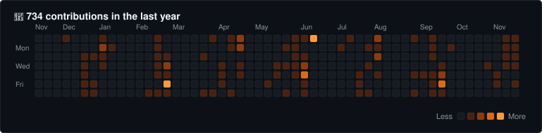

# 🎃 GitHub Contribution Graph – Halloween Orange Theme

Recreates GitHub's iconic Halloween-themed contribution graph, replacing the default green contribution squares with the original Halloween-inspired orange color palette.

---

## 🖼️ Live Halloween Contribution Graph

Here is the live generated graph for [@mahendraasingh](https://github.com/mahendraasingh) (733 contributions in the last year plotted with the 5-level Halloween palette):

<div align="center">
  
</div>

---

## 🎨 Color Palette & Intensity Levels

| Level | Intensity | Hex Code | Visual Description |
| :---: | :---: | :---: | :--- |
| **0** | No activity | `#161B22` | Dark background (*adaptive `#EBEDF0` in light mode*) |
| **1** | Low activity | `#4A210F` | Deep dark burnt orange |
| **2** | Moderate activity | `#8C3B0D` | Warm medium rust orange |
| **3** | High activity | `#D96B16` | Bright pumpkin orange |
| **4** | Maximum activity | `#FF9A3C` | Vivid glowing pumpkin orange |

---

## 🚀 How to Add This Orange Graph to Your Profile (No Extensions Needed!)

Anyone visiting your GitHub profile on phone or desktop will see your Halloween contribution graph without installing anything!

### Method 1: Using the Generated SVG from this Repo
Paste this into your profile `README.md` (e.g. in your `mahendraasingh/mahendraasingh` profile repo):

```markdown
<div align="center">
  
</div>
```

*This graph is automatically updated daily via GitHub Actions ([`.github/workflows/halloween-graph.yml`](./.github/workflows/halloween-graph.yml)).*

### Method 2: Instant ghchart Embed (Zero Configuration)
You can also embed this one-liner directly:

```markdown

```

---

## 🪄 1-Click Browser Bookmarklet (For GitHub.com Profile Page)

If you want the main profile page on `https://github.com/mahendraasingh` itself to turn orange with a single click (no extensions required):

1. Save a new bookmark in your browser bar.
2. Set the URL to:
```javascript
javascript:(function(){const isLight=document.documentElement.getAttribute('data-color-mode')==='light';const p={'0':isLight?'#EBEDF0':'#161B22','1':'#4A210F','2':'#8C3B0D','3':'#D96B16','4':'#FF9A3C'};document.querySelectorAll('[data-level]').forEach(e=>{const l=e.getAttribute('data-level');if(p[l]){e.style.setProperty('background-color',p[l],'important');e.style.setProperty('fill',p[l],'important');}});})();
```
3. Whenever you are on GitHub, click the bookmark to turn all green squares orange instantly.

---

## 📁 Repository Structure

```
├── halloween-graph.svg        # Real 52-week SVG graph for @mahendraasingh (Halloween orange)
├── .github/workflows/
│   └── halloween-graph.yml    # Daily automated workflow updating the SVG
├── manifest.json              # Optional Manifest V3 browser extension
├── style.css                  # Injection stylesheet with Primer CSS variables
├── content.js                 # Content script for Turbo navigation
├── userscript/                # Tampermonkey / Violentmonkey userscript
├── demo/                      # Offline interactive simulation & test bench
└── test/
    ├── generate_halloween_svg.mjs # SVG graph generator script
    └── verify.js              # Test suite (29 tests)
```

---

## 📄 License
MIT License.
